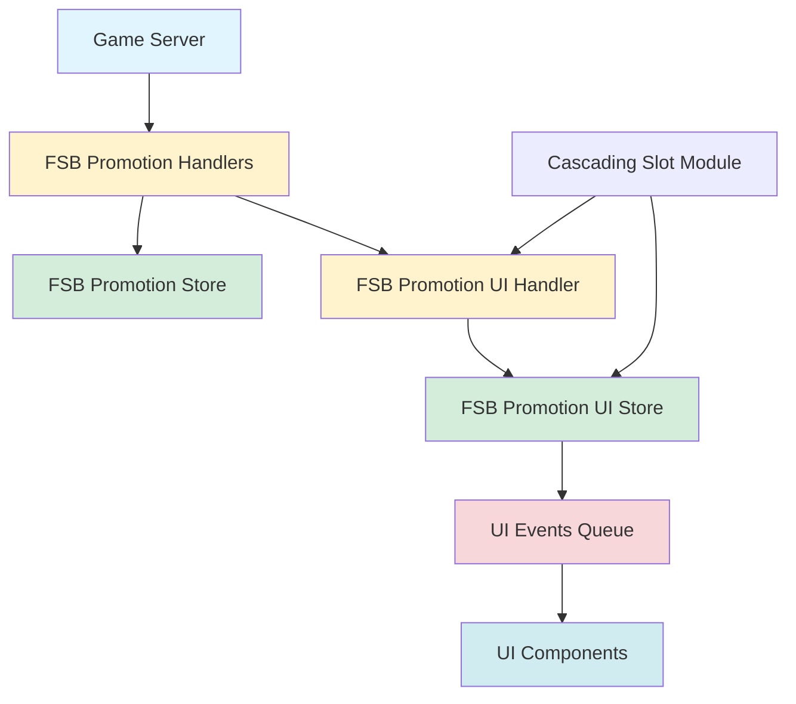
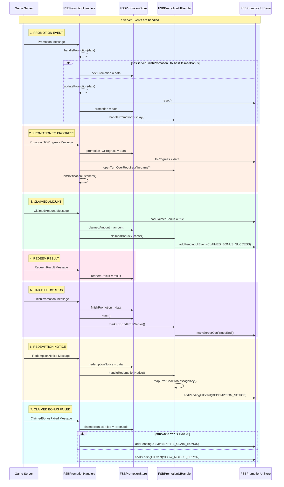
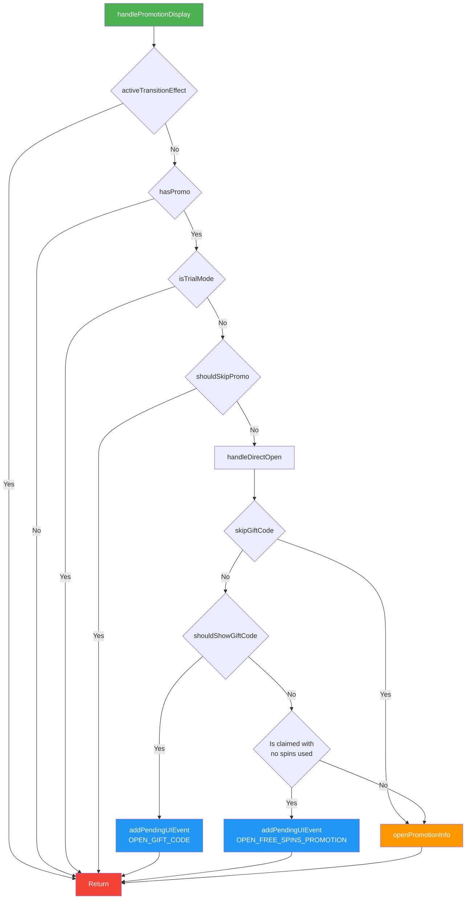
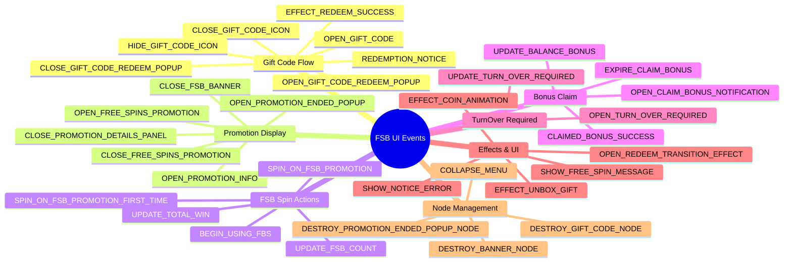
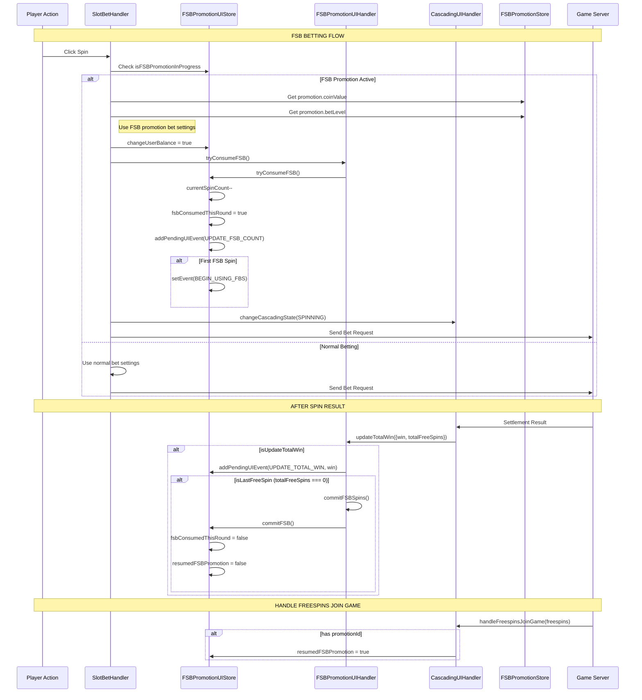
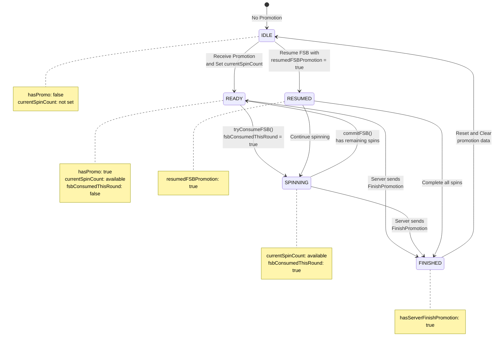
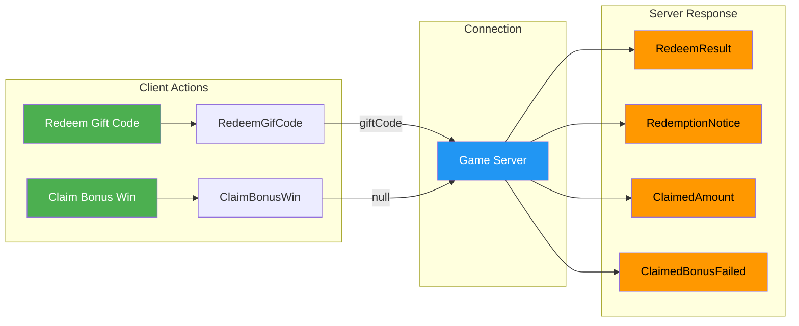
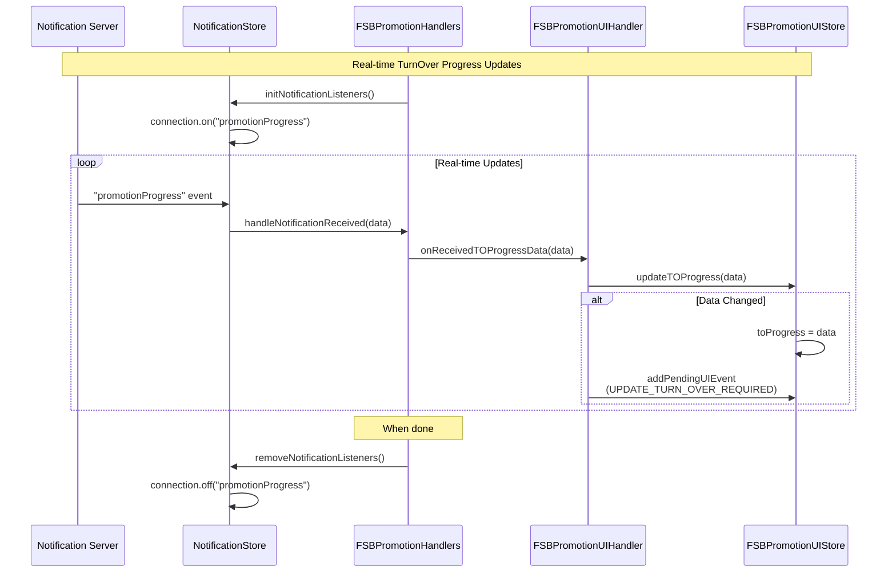
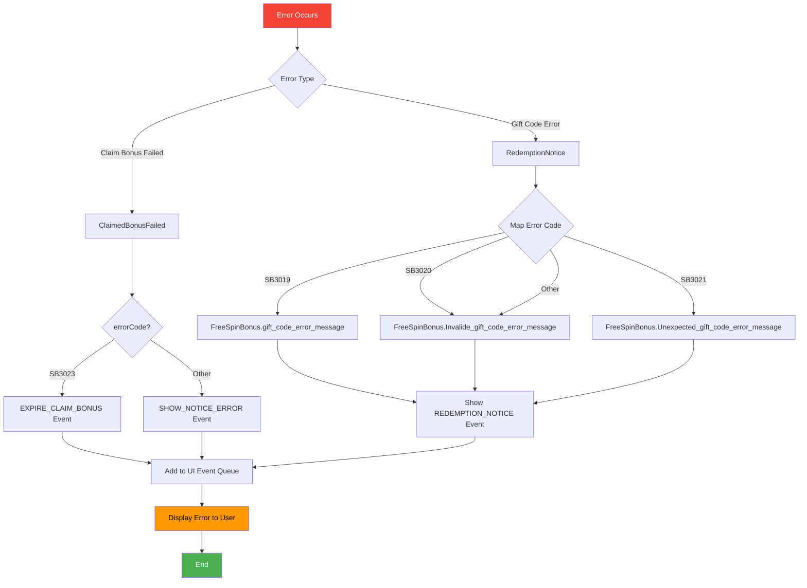
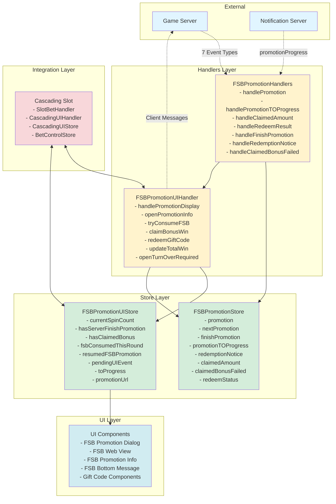

# FSB Promotion Action Flow Diagram

## Overview
FSB (Free Spin Bonus) Promotion is a system for managing free spin promotion campaigns in the game. The flow includes many actions from the server, processed through handlers, updating stores, and triggering UI events.

---

## 1. ARCHITECTURE OVERVIEW



---

## 2. SERVER MESSAGES → HANDLERS FLOW



---

## 3. UI HANDLER PROMOTION DISPLAY FLOW



---

## 4. FSB PROMOTION UI EVENTS



---

## 5. FSB INTEGRATION WITH CASCADING SLOT



---

## 6. FSB STATE MACHINE



---

## 7. CLIENT → SERVER MESSAGES



---

## 8. NOTIFICATION SYSTEM (WebSocket)



---

## 9. ERROR HANDLING FLOW



---

## 10. COMPLETE DATA FLOW



---

## 11. KEY STORES & THEIR RESPONSIBILITIES

### FSBPromotionStore (Data Store)
- **Promotion Data**: `promotion`, `nextPromotion`, `finishPromotion`
- **TurnOver Data**: `promotionTOProgress`
- **Redemption**: `redemptionNotice`, `redeemStatus`
- **Claim Results**: `claimedAmount`, `claimedBonusFailed`
- **Methods**: `reset()`, `isRedeemSuccess`, `isClaimed`

### FSBPromotionUIStore (UI State Store)
- **Spin State**: `currentSpinCount`, `fsbConsumedThisRound`, `resumedFSBPromotion`
- **FSB State Machine**: `fsbState` (IDLE, READY, SPINNING, FINISHED, RESUMED)
- **Free Spin Tracking**: `isFreeSpinInGame`, `isUsedFSBPromotionBonus`
- **Server Flags**: `hasServerFinishPromotion`, `hasClaimedBonus`, `hasShowFinishPromotion`
- **UI Events**: `pendingUIEvent`, `event`
- **TurnOver**: `toProgress`, `pendingOpenTOAfterFinish`
- **Display State**: `activeTransitionEffect`, `skipGiftCode`, `activeDetailPromo`
- **Methods**: 
  - FSB Consumption: `tryConsumeFSB()`, `undoLastFSBSpin()`, `commitFSB()`
  - State Management: `reset()`, `markServerConfirmedEnd()`, `resetFinishPromotion()`
  - UI Events: `addPendingUIEvent()`, `removePendingUIEvent()`, `setEvent()`

---

## 12. INTEGRATION POINTS

### With Cascading Slot Module

1. **SlotBetHandler**
   - Checks `fsbPromotionUIStore.isFSBPromotionInProgress`
   - Uses FSB promotion bet settings (coinValue, betLevel)
   - Sets `changeUserBalance = true` for FSB bets
   - Calls `fsbPromotionUIHandler.tryConsumeFSB()` before spin

2. **CascadingUIHandler**
   - Handles `handleFreespinsJoinGame()` - sets `resumedFSBPromotion` if has promotionId
   - Manages free spin state coordination

3. **CascadingUIStore**
   - References `FSBPromotionUIStore` for state checks
   - Coordinates UI state with FSB promotion state

### With Shared Components Module

- **Audio**: FSB promotion audio file (`fsb-promotion.mp3`)
- **Common Components**: Node containers, notices, dialogs integrate with FSB UI components
- **Utility Functions**: `FunctionUtils.isPortraitMode()` is used in URL building

---

## 13. TYPICAL USER FLOWS

### Flow 1: Gift Code Redemption
```
User receives gift code
  → Opens game
  → Server sends Promotion (isGiftCode=true, isClaimed=false)
  → handlePromotion → handlePromotionDisplay
  → shouldShowGiftCode() = true
  → OPEN_GIFT_CODE event
  → User enters code
  → redeemGiftCode() → Server
  → Server response: RedeemResult / RedemptionNotice
  → Show success/error message
  → If success: OPEN_FREE_SPINS_PROMOTION
```

### Flow 2: FSB Promotion Play
```
User has active promotion
  → Server sends Promotion (isClaimed=true)
  → OPEN_PROMOTION_INFO event
  → User clicks Play/Spin
  → SlotBetHandler checks isFSBPromotionInProgress
  → tryConsumeFSB() → currentSpinCount--
  → BEGIN_USING_FBS event (first spin)
  → UPDATE_FSB_COUNT event
  → Spin executes with FSB settings
  → updateTotalWin() after result
  → UPDATE_TOTAL_WIN event
  → Repeat until currentSpinCount = 0
  → Server sends FinishPromotion
  → OPEN_PROMOTION_ENDED_POPUP
```

### Flow 3: TurnOver Requirement
```
User completes FSB spins
  → Server sends FinishPromotion (totalWin > 0)
  → Server sends PromotionTOProgress
  → OPEN_TURN_OVER_REQUIRED event
  → Notification listener active
  → User plays to complete turnover
  → Real-time updates via "promotionProgress" notification
  → UPDATE_TURN_OVER_REQUIRED events
  → User completes turnover
  → claimBonusWin() → Server
  → Server: ClaimedAmount
  → CLAIMED_BONUS_SUCCESS event
```

---

## NOTES

### Event Handler Registration
All server events are registered in `FSBPromotionHandlers.eventHandleList`:
- `GameServiceMessageSlot.Promotion.eventName`
- `GameServiceMessageSlot.PromotionTOProgress.eventName`
- `GameServiceMessageSlot.ClaimedAmount.eventName`
- `GameServiceMessageSlot.RedeemResult.eventName`
- `GameServiceMessageSlot.FinishPromotion.eventName`
- `GameServiceMessageSlot.RedemptionNotice.eventName`
- `GameServiceMessageSlot.ClaimedBonusFailed.eventName`

### State Management
- **MobX** is used for reactive state management (`mobx.makeAutoObservable`)
- **Dependency Injection** with Inversify (`@injectable`, `@inject`)
- **UI Events Queue** pattern: `pendingUIEvent` is consumed by UI components

### Trial Mode
- In trial mode, FSB promotion features are hidden
- `isTrialMode` flag controls visibility of gift code and promotion displays

---

**Created for**: Portrait Mahjong Wins Project  
**Last Updated**: 2025-11-19  
**Modules Covered**: 
- `shared-common-slot/fsb-promotion`
- `shared-cascading-slot` (integration points)
- `shared-components` (integration points)

